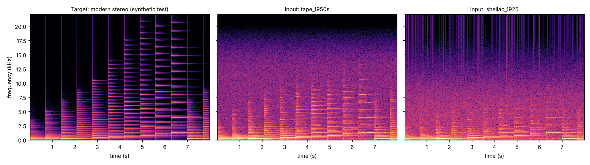

# Vintage2Modern (한국어 안내)

옛 모노 피아노 녹음을 현대적인 스테레오로 바꾸는 도구입니다. 영어 설명과 결과·한계는 저장소 맨 위 `README.md` 를 보세요.

두 단계로 동작합니다.
1. **복원 신경망 (학습)**: 스펙트로그램 U-Net 이 히스·크래클·럼블을 지웁니다. 출력은 모노입니다.
2. **공간 렌더링 (학습 없음)**: 고음 쉘빙 EQ 와 좌우가 다른 확산 잔향으로 스테레오를 만듭니다.

옛 녹음과 현대 녹음의 "짝"은 세상에 없으므로, **현대 녹음을 옛날처럼 열화시켜 짝을 만들고** 신경망이 그 반대 방향을 배웁니다.



왼쪽: 정답(테스트용 합성 신호). 가운데: 1950년대 테이프풍. 오른쪽: 1925년 SP 음반풍.

## 변환만 하려면

```bash
pip install -r requirements.txt      # mp3·webm·m4a·opus 입력은 ffmpeg 필요
python infer.py vintage2modern_v1.pt 옛녹음.mp3 결과.wav                    # 기본: 공간 프리셋 r2
python infer.py vintage2modern_v1.pt 옛녹음.mp3 결과.wav --spatial none      # 복원만 (모노)
```

변환할 녹음의 권리는 사용하는 사람에게 있습니다. 저작권이 남은 녹음의 변환 결과는 공유하지 마세요.

## 파일

| 파일 | 역할 |
|---|---|
| `degrade.py` | 열화 시뮬레이터 (프리셋: `tape_1950s`, `shellac_1925`, `acoustic_pre1925`, `mild`) |
| `make_pairs.py` | 깨끗한 녹음 폴더 → 학습용 쌍 데이터 + 메타데이터 (`--no-measured`: 실측 보정 끈 비교 실험) |
| `make_sources.py` | 데이터 출처·라이선스를 `sources.csv` 에 등록 (없거나 비상업 라이선스면 쌍 생성에서 자동 제외) |
| `convert_to_flac.py` | 무손실 파일(.m4a 등)을 FLAC 으로 변환 |
| `inspect_aalto.py`, `calibrate_tape.py` | Aalto 테이프 데이터셋 → `assets/tape_profile.npz` (실측 히스·주파수 특성·속도 흔들림) |
| `harvest_disc_noise.py` | 78rpm 파일의 앞뒤 홈 잡음 → `assets/disc_noise.npz`. 평가 파일과 같은 내용·같은 음반은 자동 제외. **공개 가중치에는 쓰지 않음** (출처 이용 조건을 확인한 잡음만 쓸 것) |
| `test_degrade.py` | 합성 신호로 시뮬레이터 전체 동작 검증 |
| `model.py` | 스펙트로그램 U-Net. `mono=True` 가 공개 모델 (v1) |
| `losses.py`, `dataset.py`, `train.py` | 손실, 쌍 데이터 로더, 학습 (bf16, 이어서 학습) |
| `spatial.py` | 공간 렌더링 (`r2`, `hall` 프리셋) |
| `infer.py`, `audio_io.py` | 변환, 오디오 읽기 |
| `compare_mono.py`, `baselines.py`, `analyze.py` | 합성 검증 데이터에서 비교 |
| `eval_real.py`, `measure_real.py` | 실제 옛 녹음(정답 없음)의 잡음 지표 (히스·럼블·험·크래클) |
| `diagnose_suppression.py` | 대역별로 무엇을 지우고 남기는지 진단 |
| `measure_attack.py` | 타건 어택 보존 측정 |
| `restore_baseline.py`, `dsp_baseline.py` | 비교용 기존 복원 모델 (Moliner & Välimäki 2022, 별도 설치) + 단순 처리 |
| `make_listening_test.py`, `analyze_listening.py` | 블라인드 청취 묶음 만들기·집계 |
| `make_figures.py`, `compare_fixes.py`, `check_noise_estimate.py` | 그림, 학습 설정 비교 실험, 자기 학습 가능성 검증 |

## 열화 체인

실제 녹음 체인 순서를 따릅니다. 모든 강도는 무작위로 뽑히고 메타데이터에 기록됩니다.

1. 스테레오 → 모노 2. 작은 방 잔향 3. 마이크 음색 4. 대역 제한 5. 다이내믹 압축 6. 테이프 포화
7. 테이프 주파수 특성(실측) 8. 속도 흔들림(실측) 9. 테이프 히스·험(실측) 10. 재생·전사 대역 제한
11. 디스크 크래클 12. 78rpm 표면 잡음(실제 홈 잡음) 13. 업로더의 잡음 제거 흔적 14. 손실 압축(Opus/AAC/MP3, 가끔 두 번)

## 처음부터 재현하기 (RTX 4090 1장 기준)

1. 환경: `pip install -r requirements.txt` → `python test_degrade.py`
2. 깨끗한 녹음 (상업 이용 가능한 것만): Open Goldberg Variations (CC0), Musopen 쇼팽 (CC0),
   Open Well-Tempered Clavier 1권 (공식 사이트는 퍼블릭 도메인이라 하지만 Bandcamp 판은 **CC BY 4.0** 표시 → 출처 표시). `data/clean/` 에 넣고 `sources.csv` 에 등록
3. 테이프 보정 자료 (공개 데이터로 직접 만듦): `python calibrate_tape.py <Aalto 폴더>`
4. 쌍 데이터 (공개 가중치와 같은 조건, 실제 홈 잡음 없이): `python make_pairs.py --src data/clean --sources sources.csv --out data/pairs8 --no-real-disc`
5. 학습 (약 6시간): `python train.py --data data/pairs8 --out runs/v8 --steps 100000 --mono --seed 0`
6. 평가: `python compare_mono.py --data data/pairs8 --steps 0 --ckpt runs/v8/best.pt`, `python eval_real.py --ckpt runs/v8/best.pt`

평가용 실제 녹음은 `real_tests/` 아래에만 두세요. 같은 녹음·같은 음반이 학습 쪽(홈 잡음 수확 포함)에 들어가면 평가가 부풀려집니다.

## 데이터 원칙

- `sources.csv` 에 없는 파일, 비상업(NC) 라이선스 파일은 `make_pairs.py` 가 자동으로 건너뜁니다 (허용: `CC0`, `PD`, `CC-BY`, `OWN`).
- 생성된 `meta.jsonl` 에 모든 쌍의 출처·라이선스·열화 파라미터가 남습니다.
